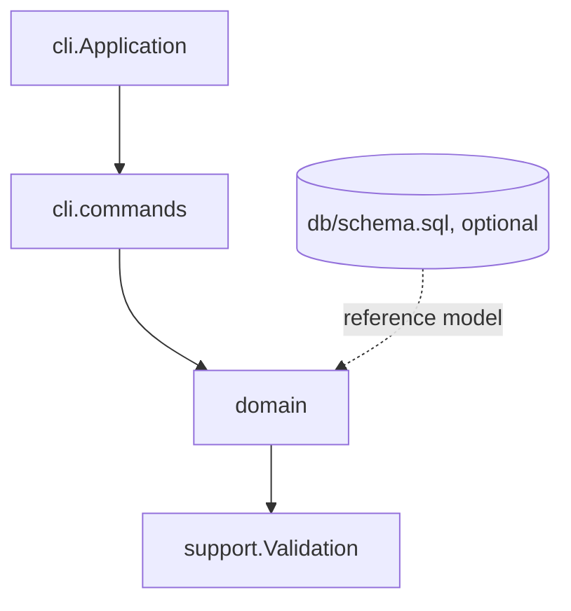

# Architecture

## Goals

1. Keep domain logic pure, deterministic, and testable without a console.
2. Reject invalid state at construction.
3. Make every random result reproducible from a seed.
4. Keep the runtime free of third-party dependencies.

## Layers

| Layer | Responsibility | May depend on |
| --- | --- | --- |
| `cli` | Parse arguments, print output, map errors to exit codes | `domain`, `support` |
| `domain` | Business rules, algorithms, statistics | `support`, JDK |
| `support` | Shared input validation | JDK |

Time enters through a `Clock` at the CLI boundary, and randomness through an explicit `SplittableRandom`. The domain never reads the system clock or an unseeded generator.

There is no client/server boundary, so a `frontend/` and `backend/` split does not apply.

## Key decisions

- **Records for values.** Compact constructors enforce invariants, so an invalid `Student` or `MatchResult` cannot exist.
- **Exact threshold comparison.** Standing compares `sum >= 4 * count` in integers, avoiding floating-point error at the boundary.
- **`BigDecimal` for vehicle price.** Decimal amounts are not subject to binary rounding.
- **Injected year.** Age calculations take a `Year`, which keeps tests independent of the date they run on.
- **Age semantics.** Only a birth year is stored, so the API is named `ageReachedIn`: the age reached during that year.

## Algorithms and complexity

Let `y` be a year, `k` the number of grades, `s` students, `n` teams, `m` matches, `r` simulation runs, and `L` the largest Poisson rate.

| Operation | Method | Time | Space |
| --- | --- | --- | --- |
| Leap year test | Gregorian rule | O(1) | O(1) |
| Leap years in a range | Inclusion-exclusion with floor division | O(1) | O(1) |
| Student average | Summation | O(k) | O(1) |
| Cohort report | One pass with Welford's recurrence | O(s k) | O(1) extra |
| Wilson interval | Closed form | O(1) | O(1) |
| Round-robin schedule | Circle method | O(n^2) | O(n^2) |
| Standings | Tally and sort | O(m + n log n) | O(n) |
| Poisson sample | Knuth's product method | O(L) expected | O(1) |
| Title odds | Monte Carlo | O(r (n^2 L + n log n)) | O(n^2) |

### Leap year counting

The number of leap years up to `y` is `floor(y/4) - floor(y/100) + floor(y/400)`. A range count is the difference of two such values. Floor division keeps the formula valid for negative proleptic years. Each 400-year cycle has exactly 97 leap years, which is verified as a property.

### Welford's recurrence

The running mean and sum of squared deviations are updated in one pass, which avoids the cancellation of the naive sum-of-squares formula. Sample variance uses Bessel's correction and is undefined for fewer than two values, so it is returned as an empty optional.

### Round-robin scheduling

The circle method fixes one team and rotates the others. An odd roster gains a virtual bye slot. For `n` slots this yields `n - 1` rounds in which every pair meets exactly once. The double round robin mirrors each round, so every team has the same number of home and away matches.

### Simulation model

Each match draws independent Poisson goals for both sides. The home rate is the team's goal rate multiplied by the home advantage. Each team's rate serves as both its attacking strength and its only strength parameter; defense is not modeled.

Teams play a double round robin, ranked by points (3/1/0), goal difference, and goals scored. Teams still tied after those criteria are separated uniformly at random with the seeded generator, which keeps each run's outcome a Bernoulli trial for each team and avoids alphabetical bias.

Each run uses `root.split()`, so a run's stream is fixed by the seed and the run index. Title probabilities carry 95% Wilson score intervals, which behave better than the normal approximation near 0 and 1.

The model is a teaching tool. It has not been calibrated against real match data.

## Verification strategy

| Technique | Examples |
| --- | --- |
| Example tests | Regression test for each corrected legacy defect |
| Oracle properties | Leap rule against `java.time.Year`, closed form against brute force |
| Invariants | Goal difference sums to zero, every pair meets once, titles sum to runs |
| Statistical tests | Chi-square fit for Poisson, binomial bounds for symmetric teams, Wilson coverage |
| Reproducibility | Identical results for identical seeds |

Property and statistical tests use fixed seeds, so results are stable across runs.

## Recommended extensions

- Add a persistence adapter behind a repository interface in a new `infrastructure` package, using `db/schema.sql`.
- Add separate attack and defense parameters to the simulation.
- Replace Knuth's sampler with a rejection method if rates well above 30 are needed.
